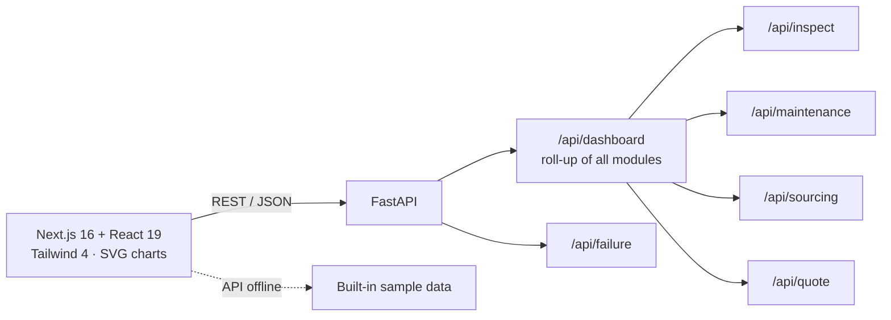

<div align="center">

# 🔩 Bearing IQ

### AI-powered intelligence platform for bearing manufacturing

Visual inspection · Quotation · Failure analysis · Predictive maintenance · Sourcing intelligence — unified in one executive command center.


*Built for Micro Turner Group by [Swagata Banerjee](https://github.com/gitswagata1)*

</div>

<p align="center">
  <a href="#-why-this-exists">Why</a> ·
  <a href="#-whats-inside">Modules</a> ·
  <a href="#-architecture">Architecture</a> ·
  <a href="#-quick-start">Quick start</a> ·
  <a href="#-demo-walkthrough">Demo</a> ·
  <a href="#-api-reference">API</a> ·
  <a href="#-troubleshooting">Troubleshooting</a> ·
  <a href="#-roadmap">Roadmap</a>
</p>

---

## 🎯 Why this exists

A bearing plant makes decisions in five disconnected places: the inspection line, the sales desk, the customer-complaint file, the shop floor and the purchase office. Bearing IQ puts an AI assistant in each of them and rolls the results into a single screen a plant head can read in 30 seconds.

## 🧩 What's inside

| Module | Question it answers | Key output |
|---|---|---|
| 📊 **Executive Command Center** | *How is the plant doing right now?* | First-pass yield, plant health, downtime cost avoided, quote pipeline, defect mix, stock vs demand |
| 🔍 **Visual Inspection** | *Is this bearing shippable?* | Pass/defect, defect type, severity grade, location, disposition |
| 💰 **Quotation Assistant** | *What should we quote, and to whom?* | Price with GST, lead time, customer history, upsell hint |
| 🔧 **Failure Analysis** | *Why did this bearing fail in the field?* | Root-cause ranking, corrective actions, fleet-wide failure patterns |
| ⚙️ **Predictive Maintenance** | *Which machine fails next, and what does it cost?* | Health score, failure probability, hours-to-failure, prevention vs breakdown cost |
| 📦 **Sourcing Intelligence** | *What should we buy this quarter?* | Demand forecast, stock cover, supplier scorecards, buy-now list |

## 🏗 Architecture



- **Single roll-up endpoint** — `GET /api/dashboard/overview` serves the whole command center in one round trip; the UI refreshes every 30 s.
- **Offline-safe frontend** — if the API is unreachable, the UI falls back to sample data and shows a clear "Sample data" indicator, so demos never break.
- **Zero chart dependencies** — donut, bar and stock charts are plain SVG: tiny bundle, no supply-chain surface.
- **Typed contracts** — every endpoint is a Pydantic model, browsable at `/docs`.

## 🚀 Quick start

**Prerequisites:** Python 3.11+ and Node.js 20+

```bash
# 1 · Backend  → http://localhost:8000/docs
cd backend
python -m venv .venv && source .venv/bin/activate   # Windows: .venv\Scripts\activate
pip install -r requirements.txt
cp .env.example .env
uvicorn main:app --reload

# 2 · Frontend → http://localhost:3000
cd frontend
npm install
npm run dev
```

Open http://localhost:3000 — the status chip in the top-right shows **Live** when the API is connected.

## 🎬 Demo walkthrough

A 5-minute tour for stakeholders:

1. **Command Center (`/`)** — read the four KPI cards, then the defect mix and machine-health bars. Hit **Refresh**: values change because the API is live.
2. **Predictive Maintenance** — open the machine at risk; compare *cost of prevention* vs *cost of breakdown*.
3. **Sourcing** — check which parts need reorder and the supplier scorecard.
4. **Inspection** — upload any bearing photo to see a verdict, defect type and severity.
5. **Quotation** — generate a quote and review the AI notes and upsell hint.
6. **Kill the backend** — the UI keeps working on sample data and flags it with a yellow banner.

## 📡 API reference

| Method | Endpoint | Description |
|---|---|---|
| GET | `/api/dashboard/overview` | Aggregated KPIs and chart data for the command center |
| POST | `/api/inspect` | Upload a bearing image, get an inspection verdict |
| GET | `/api/inspect/stats` | Inspection totals, defect rate, defect-type mix |
| POST | `/api/quote` | Generate an AI-assisted quotation |
| GET | `/api/quote/history` | Recent quotes and statuses |
| POST | `/api/failure/analyze` | Diagnose a field failure |
| GET | `/api/failure/patterns` | Failure-mode statistics |
| GET | `/api/maintenance/machines` | Health of every machine |
| GET | `/api/maintenance/alerts` | Active predictive alerts |
| GET | `/api/sourcing/forecast` | Demand forecast and stock cover |
| GET | `/api/sourcing/suppliers` | Supplier scorecards |
| GET | `/api/sourcing/recommendation` | Quarterly procurement recommendation |

## ⚙️ Configuration

| File | Variable | Purpose |
|---|---|---|
| `backend/.env` | `CORS_ORIGINS` | Comma-separated origins allowed to call the API (default `http://localhost:3000`) |
| `backend/.env` | `ANTHROPIC_API_KEY` | Reserved for LLM-backed modules |
| `frontend/.env.local` | `NEXT_PUBLIC_API_URL` | API base URL (default `http://localhost:8000`) |

## 📁 Project structure

```
bearing-iq/
├── backend/
│   ├── main.py              # app, CORS, timing middleware, routers
│   └── routers/             # dashboard · inspection · quotation · failure · maintenance · sourcing
└── frontend/
    └── src/
        ├── app/             # command center + one page per module
        ├── components/      # Sidebar, StatCard, StatusBadge, Charts (SVG)
        └── lib/             # API client, demo data
```

## 🩺 Troubleshooting

| Symptom | Fix |
|---|---|
| `localhost:3000` refuses to connect | The frontend isn't running — run `npm run dev` in `frontend/` |
| Yellow "Demo Mode" banner | Backend isn't running or `NEXT_PUBLIC_API_URL` is wrong |
| Browser console shows CORS errors | Add your frontend origin to `CORS_ORIGINS` in `backend/.env` and restart |
| PowerShell blocks `activate` | `Set-ExecutionPolicy -Scope Process Bypass`, then activate again |
| `pip install` fails on Pillow / NumPy | Use `pillow>=11` and `numpy>=2.1` for newer Python versions |
| Port already in use | `uvicorn main:app --port 8001` and update `NEXT_PUBLIC_API_URL` |

## 🗺 Roadmap

> ⚠️ **Prototype.** The inspection, maintenance and sourcing engines currently generate realistic *simulated* data behind production-shaped APIs. Numbers on screen are not live plant data.

- [x] Executive command center with live roll-up API
- [x] Five module UIs with offline sample-data fallback
- [ ] Vision model for real defect detection
- [ ] Persistent database and historical trends
- [ ] Authentication and role-based access
- [ ] ERP / MES / sensor integrations
- [ ] Docker + CI/CD deployment

## 🤝 Contributing

Branch from `main`, keep changes focused, and open a pull request describing the module touched and how you tested it.

## 👤 Author

**Swagata Banerjee** — Forward Deployed Engineering, Micro Turners · [@gitswagata1](https://github.com/gitswagata1)
